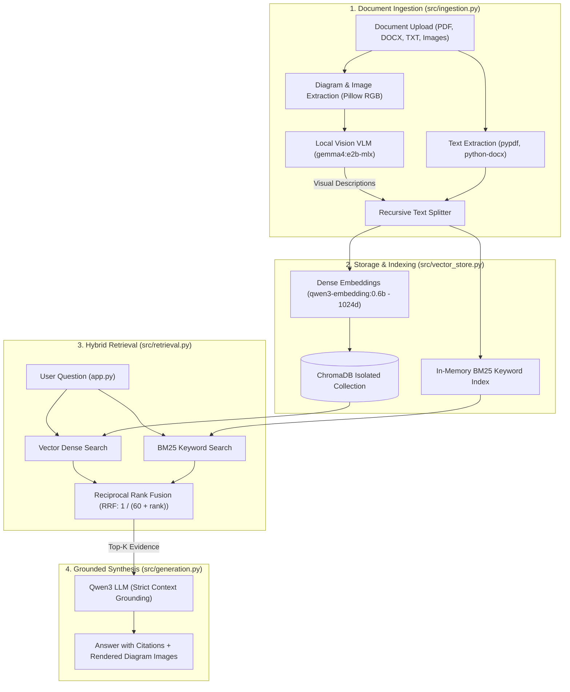

# Multimodal RAG Assistant

A local-first, privacy-preserving **Multimodal Retrieval-Augmented Generation (RAG)** assistant built for macOS Apple Silicon. 

All embeddings, vector storage, vision captioning, and LLM reasoning run **100% locally** via Ollama and ChromaDB without external API calls or data transmission.

---

## Architecture Pipeline



---

## Model Profiles & Collection Isolation

ChromaDB collections are strictly isolated by embedding model to prevent vector dimensionality collisions:

| Profile | LLM Model | Embedding Model | Vector Dims | ChromaDB Collection | Purpose |
| :--- | :--- | :--- | :--- | :--- | :--- |
| **Qwen3 (Recommended)** | `qwen3:latest` | `qwen3-embedding:0.6b` | **1024** | `docs_qwen3_embedding_0_6b` | **Default**: High reasoning, multilingual (Khmer), 128k context |
| **Gemma + Nomic (Fallback)** | `gemma4:e2b-mlx` | `nomic-embed-text:latest` | **768** | `docs_nomic_embed_text_latest` | Legacy fallback configuration |

---

## Core Features

1. **Multimodal Extraction**: Automatically extracts embedded figures, charts, and diagrams from PDFs using Pillow, saving them to `data/extracted_images/`.
2. **Vision-Language Understanding**: Local VLM analyzes visual elements and generates searchable text descriptions indexed alongside document paragraphs.
3. **Hybrid Search (Dense + Sparse)**: Blends semantic vector distance with exact lexical matches using Reciprocal Rank Fusion ($RRF = \frac{1}{60 + rank}$).
4. **Visual Citations**: Grounded answers cite exact file sources and page numbers, rendering the original diagram images directly in expandable citation cards.
5. **Interactive Chat UI**: Document upload card embedded directly inside the chat interface, with drag-and-drop and chat-input file attachments (`st.chat_input(accept_file=True)`).

---

## Quick Start

### 1. Prerequisites (Ollama Models)

Pull the required local models via Ollama:

```bash
# Recommended default models
ollama pull qwen3
ollama pull qwen3-embedding:0.6b

# Fallback / vision captioning models
ollama pull gemma4:e2b-mlx
ollama pull nomic-embed-text:latest
```

### 2. Setup Virtual Environment

```bash
cd /Users/dona/Projects/local-multimodal-rag-assistant

# Create virtual environment & install dependencies
python3 -m venv .venv
.venv/bin/pip install --upgrade pip
.venv/bin/pip install -r requirements.txt
```

### 3. Run Automated Smoke Tests

```bash
.venv/bin/pytest tests/test_assistant.py
```

### 4. Launch the Web Application

```bash
.venv/bin/streamlit run app.py
```

Open `http://localhost:8501` in your browser.

---

## Project Structure

```text
local-multimodal-rag-assistant/
├── app.py                      # Streamlit chat interface with profile switcher
├── requirements.txt            # Project dependencies
├── pyproject.toml              # Pytest configuration
├── src/
│   ├── config.py               # Model profiles, directory paths, and Ollama settings
│   ├── ingestion.py            # PDF, DOCX, TXT parsers and VLM image captioner
│   ├── vector_store.py         # ChromaDB operations with isolated collections
│   ├── retrieval.py            # Vector search, BM25 keyword matching, and RRF fusion
│   ├── generation.py           # Grounded answer synthesis with citation extraction
│   └── reembed.py              # Standalone re-embedding utility for batch documents
├── evaluation/
│   ├── benchmark.py            # Automated evaluation suite comparing model profiles
│   ├── dataset.json            # 15 ground-truth queries (text, multimodal diagrams, refusals)
│   └── benchmark_report.md     # Latest benchmark metrics and findings
├── data/
│   ├── chroma_db/              # Persistent ChromaDB SQLite vector store
│   ├── extracted_images/       # Extracted PDF diagrams and figures
│   └── uploads/                # Cached user uploaded documents
└── tests/
    └── test_assistant.py       # Comprehensive unit and integration smoke tests
```

---

## Benchmark Evaluation Results

Evaluated on **15 verified ground-truth queries** (6 text reasoning, 5 multimodal diagrams, 4 negative refusal controls) using a **Dual-Judge Consensus framework** (Judge 1: `qwen3:latest`, Judge 2: `gemma4:e2b-mlx`):

| Evaluation Metric | Qwen3 + Qwen3-Embedding (New) | Gemma 4 + Nomic (Fallback) | Advantage |
| :--- | :--- | :--- | :--- |
| **LLM Model** | `qwen3:latest` | `gemma4:e2b-mlx` | SOTA Reasoning |
| **Embedding Model** | `qwen3-embedding:0.6b` (**1024d**) | `nomic-embed-text:latest` (**768d**) | 1024 High-Res Vectors |
| **True Recall@5** | **93.3%** | 93.3% | Equal retrieval reach |
| **Precision@5** | **72.0%** | 72.0% | High-density retrieval |
| **MRR (Mean Reciprocal Rank)** | **0.933** | 0.933 | Top-1 retrieval priority |
| **Refusal Precision (Safety)** | **100.0%** | 100.0% | Zero hallucination on missing facts |
| **Citation Precision** | **100.0%** | 100.0% | Exact source and page verification |
| **Consensus Faithfulness** | **98.7%** (4.93 / 5.0) | 96.0% (4.80 / 5.0) | Grounded claims in context |
| **Consensus Answer Relevance** | **100.0%** (5.00 / 5.0) | 98.7% (4.93 / 5.0) | Full accuracy vs ground truth |
| **Inter-Judge Agreement** | **100.0%** | 93.3% | Cross-model validation |
| **Avg Retrieval Latency** | **309.2 ms** | 83.8 ms | Fast hybrid search |
| **Avg Generation Latency** | **15.77 s** | 4.91 s | Gemma (no thinking mode) |
| **Memory Footprint** | **33.1 MB** | 29.3 MB | Ultra-lightweight RAM |

To re-run the benchmark suite:
```bash
.venv/bin/python evaluation/benchmark.py
```

---

## Batch Document Re-embedding

To re-embed all documents in `data/uploads/` into a specific collection:

```bash
# Re-embed for Qwen3 (1024 dimensions)
.venv/bin/python src/reembed.py qwen3

# Re-embed for Gemma + Nomic (768 dimensions)
.venv/bin/python src/reembed.py gemma_nomic
```
